<div align="center">

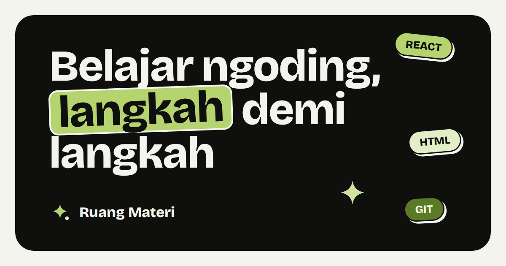

# Ruang Materi

**Belajar ngoding, langkah demi langkah.**
Materi pemrograman berbahasa Indonesia yang bisa dibuka langsung di browser: bacaan, latihan kode, kuis, flashcard, dan ujian. Gratis, tanpa unduh, tanpa wajib daftar.

[**Buka Ruang Materi →**](https://ruang-materi.mujahidin.my.id) · [Lihat contoh sertifikat](https://ruang-materi.mujahidin.my.id/sertifikat/contoh)


</div>

---

## Sekilas

Ruang Materi mengubah slide kuliah atau pelatihan (PowerPoint) menjadi kelas interaktif. Setiap kelas dipecah menjadi bab yang bisa dibaca seperti artikel, dilengkapi contoh kode, kuis singkat, latihan kode yang dijalankan di browser, flashcard, dan ujian akhir. Pelajar yang lulus mendapat sertifikat yang bisa dicek keasliannya.

| | |
| --- | --- |
| **17 kelas**, 661 slide | HTML, CSS, JavaScript, React, Vue, Node.js, Express, SQL, Python, Git, Figma, dan lainnya |
| **3 roadmap** | Frontend Web, Git dan kolaborasi, Backend Dasar |
| **100% gratis** | Semua materi bisa dibaca tanpa akun. Akun hanya untuk menyimpan progres |

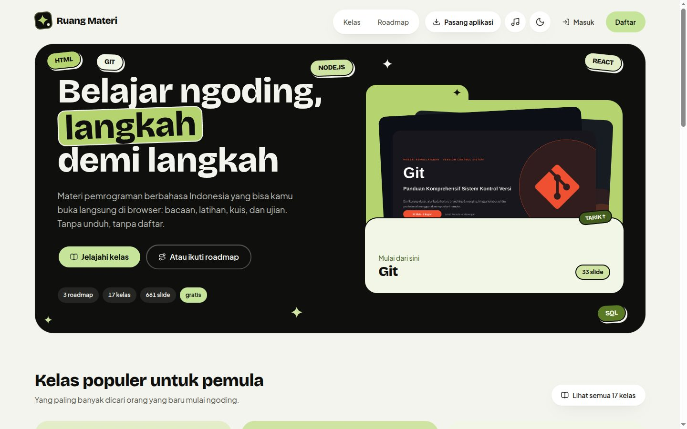

## Fitur

### Kelas yang dipecah per bab

Setiap kelas punya daftar bab dengan estimasi waktu, jumlah soal, dan jalur menuju sertifikat. Pelajar bisa mulai dari mana saja, atau ikut urutan roadmap.

| Semua kelas | Halaman kelas |
| --- | --- |
| 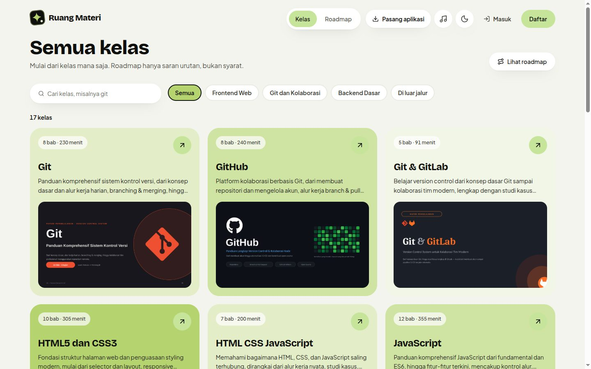 | 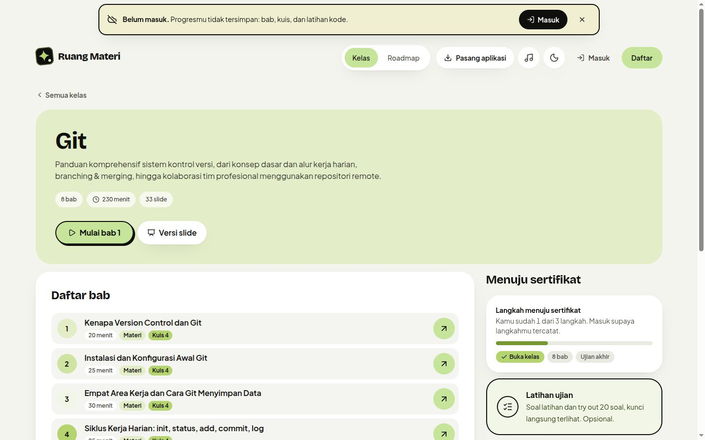 |

### Bacaan yang enak diikuti

Bab ditulis seperti artikel: tujuan bab di awal, contoh kode dengan tombol salin, slide yang disisipkan di tempat yang pas, dan daftar isi yang menandai bagian yang sedang dibaca. Tidak suka membaca? Ganti ke **versi slide** dengan satu klik.

| Bacaan | Versi slide |
| --- | --- |
| 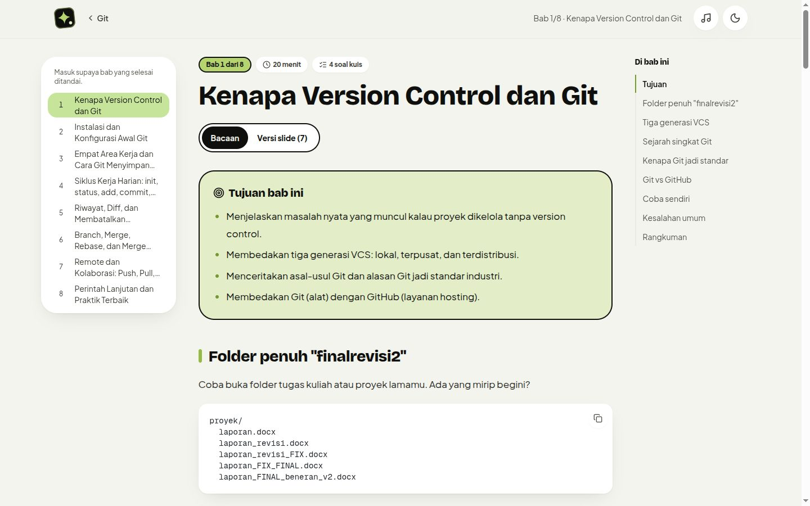 | 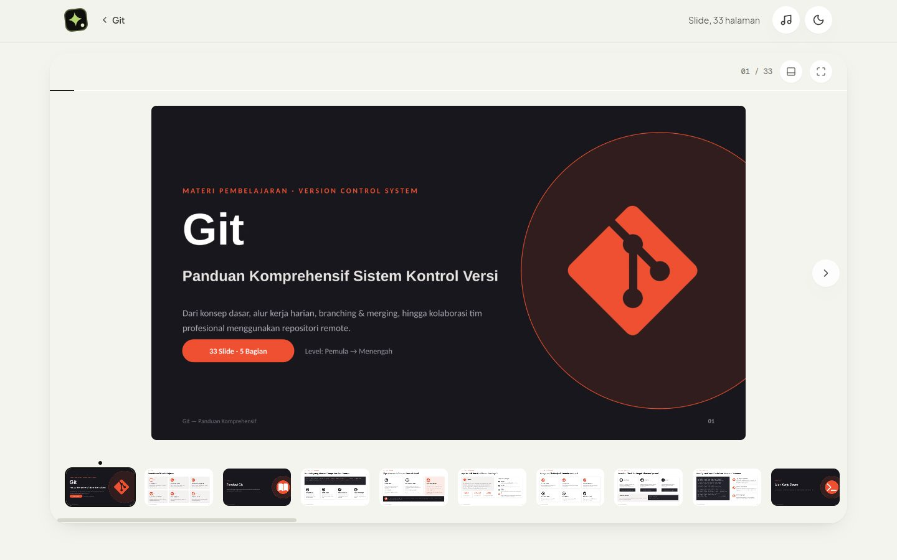 |

### Cek pemahaman yang ngasih umpan balik

Kuis di akhir setiap bab memberi umpan balik instan: efek dan suara saat benar, getar dan suara saat salah, lalu tombol **Coba lagi**. Setelah dua kali salah, pembahasan bisa dibuka. Di akhir kuis ada ringkasan soal mana saja yang perlu dibaca ulang. Kalau pelajar mau lanjut bab sebelum kuis beres, Ruang Materi mengingatkan dulu, tapi tetap boleh dilewati.

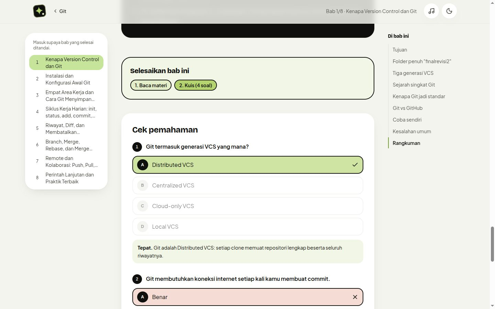

### Latihan kode, flashcard, dan ujian

- **Latihan kode** ditulis dan dijalankan langsung di browser (HTML/CSS, JavaScript, Express, Python), lalu dicek otomatis oleh tes.
- **Flashcard** dengan jadwal berulang (sistem Leitner): kartu yang lupa muncul lagi besok, yang sudah hafal jaraknya makin lama.
- **Ujian akhir** dengan timer, jawaban yang tersimpan otomatis, dan penilaian di server, bukan di browser.

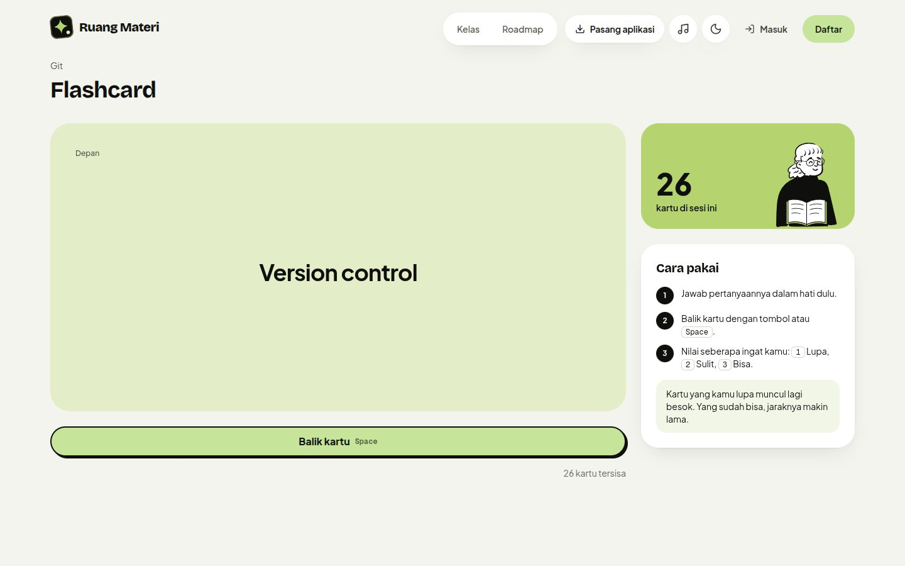

### Roadmap dan sertifikat

Roadmap menyusun kelas menjadi jalur belajar. Pelajar yang menyelesaikan semua bab dan lulus ujian akhir mendapat **sertifikat atas namanya**, lengkap dengan kode unik dan QR yang mengarah ke halaman verifikasi. Sertifikat bisa diunduh sebagai PNG atau disimpan sebagai PDF.

| Roadmap | Contoh sertifikat |
| --- | --- |
| 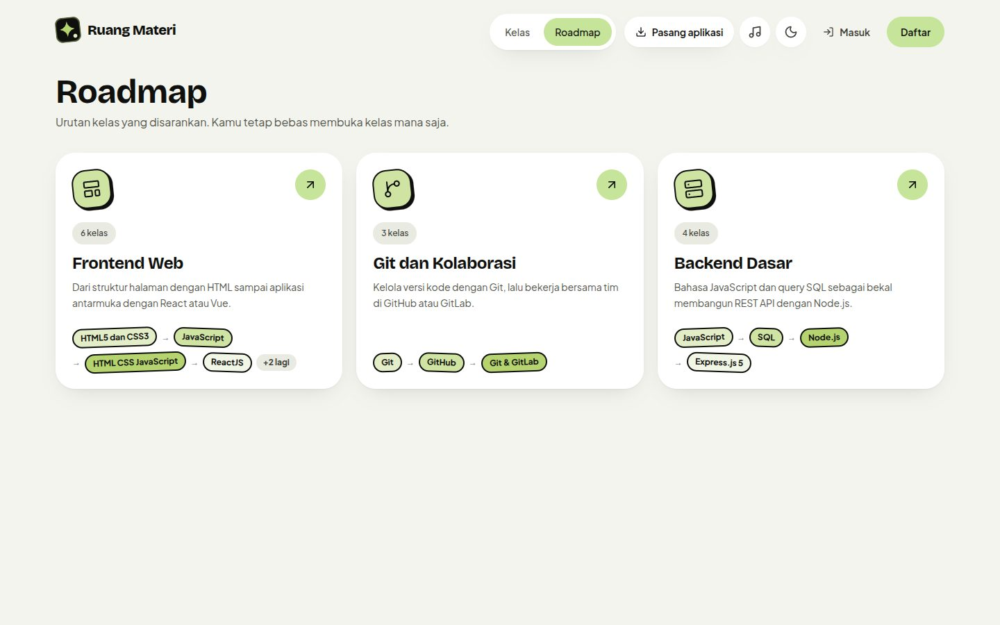 | 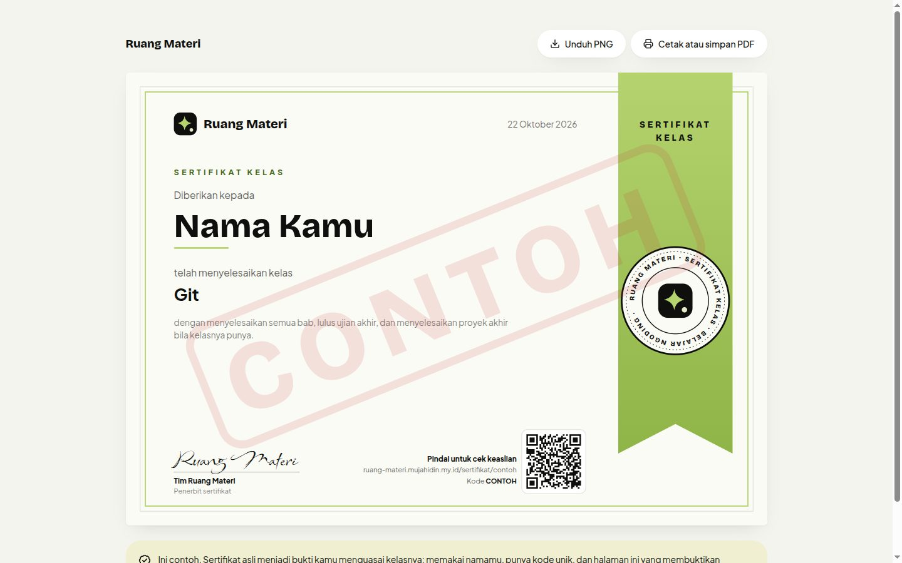 |

### Belajar sambil dengerin musik

Tombol ♪ di header membuka pemutar musik di jendela kecil, jadi lagunya tetap jalan saat pindah halaman.

- Playlist belajar Spotify yang tinggal klik (diputar penuh kalau sudah masuk ke Spotify).
- Hubungkan YouTube Music untuk mencari lagu dan memutar playlist sendiri.
- Putar file musik dari perangkat sendiri, tanpa diunggah ke mana pun.
- Riwayat "Terakhir diputar" untuk memutar ulang dengan sekali klik.

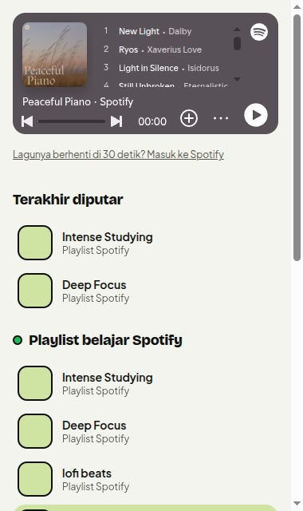

### Nyaman di HP, ada mode gelap

Tampilan dirancang dari layar HP dulu, dengan navigasi bawah yang mudah dijangkau jempol. Ruang Materi juga bisa dipasang sebagai aplikasi (PWA) dan dibuka saat offline. Mode gelap tersedia lewat satu tombol.

| HP: beranda | HP: halaman kelas | Mode gelap |
| --- | --- | --- |
| 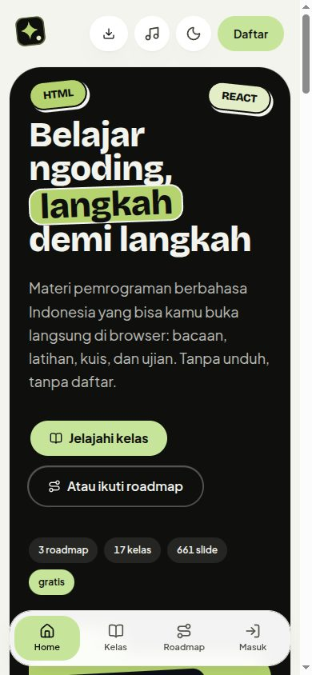 | 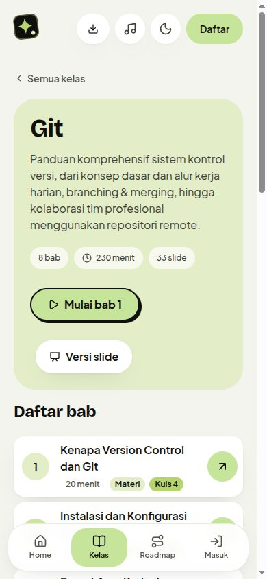 | 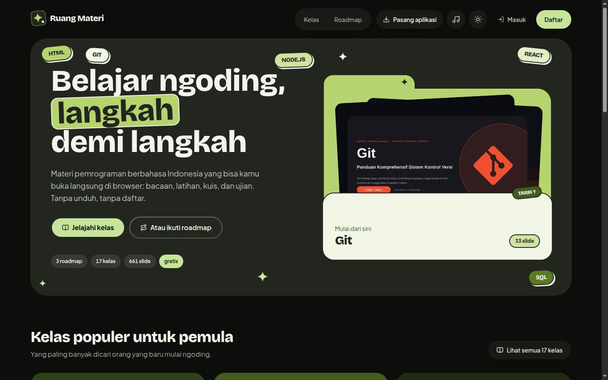 |

### Privasi yang serius

Data yang disimpan sesedikit mungkin dan mengikuti UU Pelindungan Data Pribadi (UU 27/2022). Tidak ada iklan dan tidak ada pelacak pihak ketiga. Pelajar bisa mengunduh semua datanya sebagai JSON dan menghapus akunnya sendiri dari halaman Profil.

## Teknologi

| Bagian | Yang dipakai |
| --- | --- |
| Web | Astro 7 (`output: "server"`) dengan React 19 sebagai island, Tailwind CSS 4 |
| Data dan login | Supabase: Postgres dengan RLS, fungsi database untuk penilaian, Auth (email, password, Google), Storage untuk slide |
| Hosting | Vercel (region Seoul), service worker untuk mode offline |
| Impor materi | GitHub Actions merender `.pptx` dan meminta LLM menyusun draf bab, soal, dan flashcard |
| Editor kode | CodeMirror 6, dengan runner untuk HTML, JavaScript, Express, dan Python |
| Tes | Vitest, Playwright (end-to-end), pgTAP (keamanan database) |

## Cara Kerja

- **Konten** ada di Supabase: topik, slide, tips, flashcard, dan soal di database; gambar slide (AVIF, 3200px dan 1600px) di Storage `slides/<slug>/<folder>/`.
- **Impor**: admin mengunggah `.pptx` di `/admin/impor`. GitHub Actions (`.github/workflows/import-deck.yml`) merender slide dan meminta LLM (Gemini atau OpenRouter) membuat draf ringkasan, tips, flashcard, dan soal. Draf ditinjau lalu diterbitkan di `/admin/topik`.
- **Kelas**: tiap topik adalah kelas berisi bab: bacaan markdown dengan contoh kode dan slide yang disisipkan, kuis singkat per bab, lalu latihan, flashcard, dan ujian akhir. Bab disusun AI dari deck dan bisa ditulis atau diedit admin.
- **Belajar**: murid masuk lewat tautan email atau kata sandi. Progres, review flashcard, dan ujian dinilai di database (RLS dan fungsi Postgres), bukan di browser.

Aturan kode, keamanan, dan rencana fitur lengkap ada di `GUIDELINE.md`.

## Menjalankan Secara Lokal

Isi `.env.local` (lihat `GUIDELINE.md` untuk daftar lengkap):

```
NEXT_PUBLIC_SUPABASE_URL=...
NEXT_PUBLIC_SUPABASE_PUBLISHABLE_KEY=...
```

Opsional, untuk pemutar musik: `GOOGLE_CLIENT_ID` (YouTube Music) dan `SPOTIFY_CLIENT_ID`.

```bash
npm install
npm run dev
```

Buka [http://localhost:4321](http://localhost:4321).

Database lokal untuk mengetes migrasi:

```bash
npx supabase start
npx supabase db reset
npx supabase test db
```

## Struktur Proyek

- `src/pages/`: halaman Astro 7 (dirender per request di Vercel), `src/layouts/`, `src/middleware.ts`.
- `components/`: komponen React; yang interaktif dipasang sebagai island.
- `lib/actions/`: fungsi server yang dipanggil browser lewat `/rpc/<nama>`.
- `lib/`: helper tanpa React (`content.ts`, `dal.ts`, `exam.ts`, `leitner.ts`, `level.ts`, `roadmap.ts`, `supabase/`).
- `supabase/migrations/`: skema, RLS, fungsi. `supabase/tests/`: smoke test keamanan (pgTAP).
- `worker/`: worker impor deck yang dijalankan GitHub Actions.
- `scripts/`: `db-push`, `draft-decks`, `backfill-slide-variants`, `ilustrasi` (menggambar ilustrasi di `public/ilustrasi/`).
- `public/sw.js`: service worker untuk mode offline.
- `docs/screenshots/`: gambar untuk README ini.

## Skrip

| Perintah                           | Keterangan                                                                       |
| ---------------------------------- | -------------------------------------------------------------------------------- |
| `npm run dev`                      | Jalankan server pengembangan Astro                                               |
| `npm run check`                    | Typecheck `.ts`, `.tsx`, dan `.astro`                                            |
| `npm run build`                    | Build untuk produksi                                                             |
| `npm run lint`                     | Jalankan ESLint                                                                  |
| `npm run test:run`                 | Jalankan Vitest sekali                                                           |
| `npm run test:e2e`                 | Test end-to-end Playwright sebagai tamu (`E2E_BASE_URL`, default localhost:4321) |
| `npm run db:push`                  | Kirim migrasi ke database produksi lewat session pooler                          |
| `npm run draft:decks -- <slug>...` | Buat draf materi dari deck migrasi                                               |

CI (`.github/workflows/ci.yml`) menjalankan typecheck, lint, Vitest, dan smoke test database di setiap push. `.github/workflows/e2e.yml` menjalankan test end-to-end ke setiap deploy produksi Vercel.

## Kredit

Ilustrasi dirakit dari [Open Peeps](https://www.openpeeps.com) karya Pablo Stanley (CC0), lewat paket `react-peeps`.

---

<div align="center">

Dibuat oleh **Mujahidin** · [ruang-materi.mujahidin.my.id](https://ruang-materi.mujahidin.my.id)

</div>
